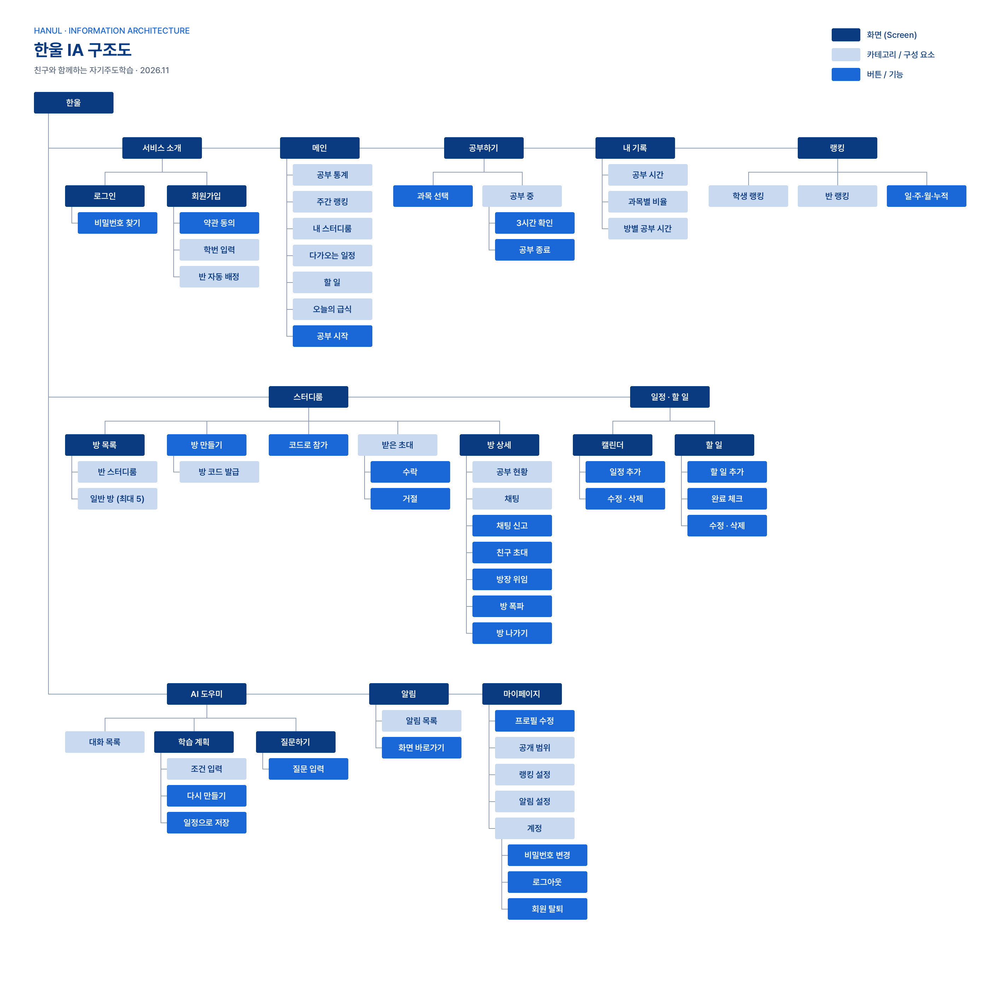
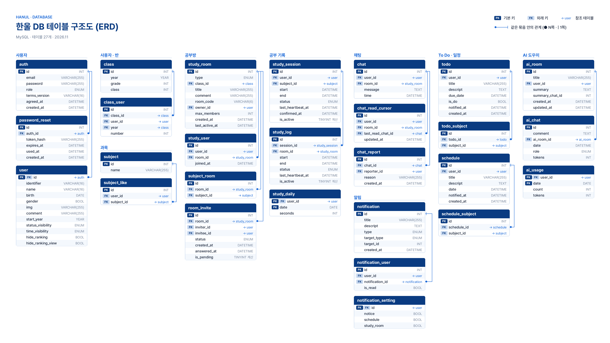

# 한울

> 친구와 함께하는 자기주도학습

생성형 AI가 학생에게 맞춘 학습 계획을 세워 주고, 친구들과 실시간으로 공부 현황을 나누며 함께 공부할 수 있는 웹 서비스

- 대상: 고등학생 (현재는 미림마이스터고등학교 학생)
- 환경: PC 웹
- 기간: 2026.08.10 ~ 2026.11 (2학기)
- 미림마이스터고등학교 2학년 「웹 응용 SW 프로그래밍 실무」 과목 프로젝트 수행평가

## 🔗 접속하기

**https://hanul-production.up.railway.app/html/**

위 배포 주소로 접속하면 됩니다!
회원 가입 시에, 입학년도를 `2025`로, 학번은 `2120`로 해 주세요! (만약, 이미 사용 중인 학번일 경우에는 2118 이상으로 아무 학번으로 시도해도 됩니다.)

**만약 접속이 안될 경우 Railway 포트 접속이 학교 와이파이로 인해 막혀 차단되었을 수도 있습니다! 이럴 경우 VPN을 사용해야 합니다...**

- 간단한 서비스 소개 화면이 먼저 나오고, 로그인하면 메인 화면으로 이동합니다.
- PC 화면(가로 1920px) 기준
- `client/html/` 폴더의 HTML 파일을 직접 열면 서버 API에 연결되지 않아 화면이 동작하지 않기에 반드시 배포 주소로 접속해야 합니다!

---

## 만든 이유

공부 시간을 친구와 나누는 서비스는 이미 많만 동기를 주는 데서 끝날 뿐, 어떻게 공부할지 계획을 세워 주지는 않습니다. 그래서 학생들은 계획을 직접 세우거나 일정 앱이나 AI 서비스를 따로 함께 써야 합니다.

한울은 다음 세 가지를 한곳에 모았습니다.

1. **AI 학습 계획**: 시험 일정, 공부할 수 있는 시간, 할 일을 입력하면 계획을 생성해줍니다.
2. **함께 공부하기**: 반 친구나 원하는 친구들과 스터디룸에서 서로 공부하는 모습을 실시간으로 볼 수 있습니다.
3. **기록과 관리**: 공부 시간, 일정, 할 일, 알림을 한 화면에서 관리합니다.

동기 부여에 그치지 않고 꾸준히 스스로 공부하는 습관을 만들도록 돕는 것이 서비스의 목표입니다.

---

## 화면 구성 (IA)



| 화면              | 주소                                       | 내용                                                                                       |
| ----------------- | ------------------------------------------ | ------------------------------------------------------------------------------------------ |
| 서비스 소개       | `/html/`                                   | 첫 화면. 로그인·회원가입으로 이동                                                          |
| 로그인 · 회원가입 | `/html/login.html`, `/html/signup.html`    | 회원가입은 2단계 (이메일·비밀번호 → 이름·아이디·학번)                                      |
| 메인              | `/html/main.html`                          | 공부 통계, 주간 랭킹, 내 스터디룸, 달력, 다가오는 일정, 할 일, 오늘의 급식, 읽지 않은 알림 |
| 스터디룸          | `/html/study-room.html`, `/html/room.html` | 방 목록, 방 안 공부 현황·채팅                                                              |
| 랭킹              | `/html/rank.html`                          | 일간·주간·월간·종합 랭킹                                                                   |
| AI 도우미         | `/html/ai-assistant.html`                  | 학습 계획 만들기, 질문하기, 대화 기록                                                      |
| 마이페이지        | `/html/settings.html`                      | 프로필 사진, 이름, 아이디                                                                  |

---

## 주요 기능

### 회원

- 이메일, 비밀번호, 이름, 아이디, 학번 4자리를 받아 가입한다. 성별, 입학년도, 생년월일은 선택 항목이다.
- 학번을 입력하면 학년·반·번호가 정해지고 그 반에 배정된다. 예를 들어 `2105`는 2학년 1반 5번이다.
- 비밀번호는 이메일로 재설정한다. 링크는 30분 동안 쓸 수 있다.
- 새 학년도가 되면 반을 다시 등록할 수 있다.
- 내 공부 현황을 누구에게 보여 줄지 고를 수 있다: 전체, 같은 반, 같은 스터디룸, 비공개.
- 마이페이지에서 프로필 사진을 올린다. 사진은 Cloudinary에 저장되고, 메인·스터디룸의 프로필 카드에도 보인다.

### 공부 시간 측정

- 과목을 고르고 공부를 시작하면, 같은 방에 있는 사람들에게 바로 표시된다(Socket.IO).
- 3시간마다 계속 공부하고 있는지 묻는다. 30초 안에 답하지 않으면 측정이 끝나서 공부 시간이 부풀려지지 않는다.
- 창을 닫아서 연결이 2분 넘게 끊겨도 측정이 끝난다.
- 공부 시간은 한국 시간 자정을 기준으로 날짜마다 나눠 저장한다. 일간·주간·월간·누적 집계에 쓰기 위해서다.

### 스터디룸

- **반 스터디룸**: 반마다 자동으로 만들어진다. 같은 반 친구들의 공부 현황을 보고 채팅할 수 있다.
- **일반 스터디룸**
  - 만들 때 방 이름, 최대 인원(2~30명), 과목 키워드(선택, 최대 3개)를 정한다.
  - 영문 대문자와 숫자로 된 6자리 방 코드가 나온다. 이 코드를 입력하거나 방장의 초대를 수락하면 들어올 수 있다.
  - 한 사람이 최대 5개 방에 참여할 수 있다(반 스터디룸 제외). 여러 방에 동시에 참여할 수 있다.
  - 방장은 방 삭제, 방장 넘기기, 내보내기, 초대를 할 수 있다. 참여자는 방에서 나갈 수 있다.
  - 마지막 활동(참가·공부·채팅)이 있고 30일이 지나면 방이 자동으로 삭제된다.
- **채팅**
  - 실시간 채팅을 지원하고, 지난 기록은 30개씩 더 불러온다.
  - 방마다 안 읽은 메시지 수를 보여 주고, 새 채팅이 오면 알림을 보낸다.
  - 부적절한 채팅은 신고할 수 있다.

### AI 도우미 (Google Gemini)

- **학습 계획 만들기**: 시험 일정, 공부할 수 있는 시간, 할 일을 입력하면 계획을 만들어 준다. 앞으로 2주 동안의 내 일정도 함께 반영한다.
- **다시 만들기**: 계획이 마음에 들지 않으면 의견을 적어 다시 만들 수 있다.
- **바로 저장**: 완성된 계획을 일정과 할 일로 한 번에 저장한다.
- **질문하기**: 공부하다 궁금한 개념이나 공부 방법을 물어보면 답해 준다. 대화 기록은 대화방별로 저장된다.
- 대화가 길어지면 앞부분을 요약해 두고 이어서 대화한다.
- 비용을 관리하려고 1인당 하루 사용 횟수(기본 20회)를 제한한다. 전체 사용자의 월 토큰 상한도 설정할 수 있다.

### 일정 · 할 일 · 알림

- 달력으로 일정을 관리하고 다가오는 일정을 확인한다. 할 일은 완료 체크와 전체 완료를 지원한다. 일정과 할 일에는 과목을 최대 3개까지 연결할 수 있다.
- 알림
  - **일정**: 일정이나 할 일 마감 24시간 전에 알려 준다.
  - **공지**: 관리자가 보낸다.
  - **스터디룸**: 새 채팅이 오면 알려 준다.
  - 알림 종류마다 켜고 끌 수 있다.

### 오늘의 급식

- NEIS 교육정보 개방 포털에서 조식·중식·석식을 받아 와 메인 화면에 보여 준다. 지금 시각에 맞는 식사를 먼저 보여 준다.

---

## 데이터베이스 (ERD)



MySQL 테이블 27개를 7개 묶음으로 나눴다. 전체 정의는 [docs/mysql.sql](docs/mysql.sql)에 있다.

| 묶음               | 테이블                                                                                                 | 내용                                                       |
| ------------------ | ------------------------------------------------------------------------------------------------------ | ---------------------------------------------------------- |
| 사용자             | `auth`, `password_reset`, `user`                                                                       | 로그인 정보, 비밀번호 재설정, 프로필·공개 범위·랭킹 숨기기 |
| 사용자 · 반 · 과목 | `class`, `class_user`, `subject`, `subject_like`                                                       | 학년도별 반 배정, 과목, 관심 과목                          |
| 공부방             | `study_room`, `study_user`, `subject_room`, `room_invite`                                              | 반·일반 스터디룸, 참여자, 키워드, 초대                     |
| 공부 기록          | `study_session`, `study_log`, `study_daily`                                                            | 공부 세션, 방별 기록, 날짜별 합계                          |
| 채팅 · 알림        | `chat`, `chat_read_cursor`, `chat_report`, `notification`, `notification_user`, `notification_setting` | 채팅, 읽음 위치, 신고, 알림과 알림 설정                    |
| To Do · 일정       | `todo`, `todo_subject`, `schedule`, `schedule_subject`                                                 | 할 일, 일정과 연결된 과목                                  |
| AI 도우미          | `ai_room`, `ai_chat`, `ai_usage`                                                                       | 대화방(요약 포함), 대화 기록, 하루 사용량                  |

모든 시각은 한국 시간(KST)으로 저장한다.

---

## 기술 스택

| 구분          | 사용 기술                                                              |
| ------------- | ---------------------------------------------------------------------- |
| 프론트엔드    | HTML, CSS, JavaScript (프레임워크 없음)                                |
| 백엔드        | JavaScript (Node.js, CommonJS), 직접 만든 경량 라우터 (`http` 모듈), Socket.IO |
| 데이터베이스  | MySQL (Railway)                                                        |
| 인증          | JWT (httpOnly 쿠키), bcrypt                                            |
| 외부 API      | Google Gemini API, NEIS 교육정보 개방 포털                             |
| 이미지 저장   | Cloudinary (프로필 사진, 스터디룸 썸네일)                              |
| 메일          | Nodemailer (SMTP)                                                      |
| 배포          | Railway (서버 + DB)                                                    |
| 기획 · 디자인 | Notion, Figma                                                          |
| 개발 환경     | Visual Studio Code, GitHub                                             |

### 서버

서버는 JavaScript로 작성했고 Node.js에서 실행됩니다.
모듈은 CommonJS(`require` / `module.exports`) 방식입니다.

웹 프레임워크(Express 등)는 쓰지 않습니다. Node.js 기본 `http` 모듈 위에 필요한 기능만 직접 만든 경량 도구(`server/http/`)로 API와 화면 파일을 제공합니다.

| 파일 (`server/http/`) | 하는 일                                                                         |
| --------------------- | ------------------------------------------------------------------------------- |
| `router.js`           | 주소별 처리 (`/rooms/:roomId`), 미들웨어 연결, async 오류 전달                  |
| `request.js`          | 쿼리·쿠키·JSON 본문 읽기 (본문 1MB 제한, 잘못된 JSON은 400)                     |
| `response.js`         | `res.json`, `res.status`, 로그인 쿠키 설정·삭제, 이동(redirect)                 |
| `static.js`           | `client` 폴더 화면 파일 제공 (파일 종류 지정, 캐시, `../`·숨김 파일 경로 차단) |

| 패키지                                 | 용도                                                  |
| -------------------------------------- | ----------------------------------------------------- |
| `socket.io`                            | 실시간 공부 현황, 채팅, 알림                          |
| `mysql2`                               | MySQL 연결 (연결마다 세션 시간대를 KST로 맞춤)        |
| `jsonwebtoken`, `bcryptjs`, `cookie`   | 로그인 토큰, 비밀번호 암호화, 쿠키 읽기·쓰기          |
| `@google/genai`                        | AI 도우미 (Gemini, 일정·할 일 추가 도구 포함)         |
| `nodemailer`                           | 비밀번호 재설정 메일                                  |
| `node-cron`                            | 예약 작업 (오래된 방 정리, 마감 알림, 공부 자동 종료) |
| `dotenv`                               | 환경 변수 (`server/.env.local`)                       |

| 명령 (`server` 폴더) | 내용                                                        |
| -------------------- | ----------------------------------------------------------- |
| `npm start`          | 서버 실행 (`node server.js`)                                |
| `npm run dev`        | 파일이 바뀌면 자동으로 다시 시작 (`node --watch server.js`) |
| `npm run db:check`   | DB 연결 확인                                                |

Cloudinary 업로드는 별도 패키지 없이 서버가 서명만 만들고, 브라우저가 Cloudinary에 바로 올립니다.

---

## 폴더 구조

```
Hanul/
├─ package.json        # 배포용: server 설치·실행 (Railway가 루트에서 실행)
├─ client/             # 프론트엔드 (서버가 정적 파일로 제공)
│  ├─ html/            # 페이지
│  ├─ css/
│  ├─ js/
│  │  ├─ api.js        # 서버 API 공통 함수 (/api 상대 경로로 요청)
│  │  └─ pages/        # 페이지별 스크립트
│  ├─ component/       # 공통 사이드바·푸터
│  └─ assets/          # 아이콘, 로고, 이미지
├─ server/
│  ├─ server.js        # 시작 파일 (HTTP + Socket.IO)
│  ├─ app.js           # 요청 처리 순서 (요청 읽기 → 화면 파일 → /api → 오류 처리)
│  ├─ http/            # 직접 만든 경량 라우터·요청·응답·정적 파일 도구 (Express 대신)
│  ├─ config/          # 환경 변수, DB 연결
│  ├─ router/          # /api/* 라우터
│  ├─ controllers/     # 요청 검증·응답
│  ├─ services/        # 비즈니스 로직 (AI, 급식, 공부 측정, 알림, Cloudinary 등)
│  ├─ models/          # SQL
│  ├─ socket/          # 실시간 공부 현황·채팅
│  ├─ jobs/            # 예약 작업 (방 정리, 마감 알림)
│  └─ utils/
└─ docs/
   ├─ assets/          # IA 구조도, ERD
   ├─ mysql.sql        # 전체 테이블
   ├─ seed.sql         # 초기 데이터 (과목)
   └─ migrations/      # 이미 만든 DB에 적용할 변경분
```

프론트엔드와 API를 같은 서버에서 제공합니다. 그래서 클라이언트는 `/api/...` 상대 경로로 요청하고, 쿠키나 CORS를 따로 설정하지 않아도 됩니다.

---

## 배포 (Railway)

서비스는 Railway에 서버와 DB를 함께 배포했습니다.

- 저장소 루트의 `package.json`이 `server`를 설치하고 실행합니다. 그래서 Root Directory는 비워 둡니다. `server`로 지정하면 `client` 폴더가 빠져서 화면이 404가 됩니다.
- 환경 변수는 Railway Variables에서 관리하며, 항목은 [server/.env.example](server/.env.example)에 있습니다.
  - DB 접속 정보, `JWT_SECRET`
  - `GEMINI_*`(AI), `NICE_*`(급식), `CLOUDINARY_*`(프로필 사진), `SMTP_*`(메일)
  - `NODE_ENV=production`(로그인 쿠키에 `secure` 적용), `APP_URL`(배포 주소)

---

## 고민한 점과 대응

| 예상한 문제                     | 대응                                                                       |
| ------------------------------- | -------------------------------------------------------------------------- |
| AI API 비용, 토큰 한도          | 1인 하루 사용 횟수 제한, 전체 월 토큰 상한, 긴 대화 요약, 가벼운 모델 사용 |
| 공부 시간 부풀리기              | 3시간마다 응답 확인, 창을 닫으면 자동 종료                                 |
| 사생활 침해                     | 공부 현황 공개 범위 선택(전체/반/스터디룸/비공개), 랭킹 숨기기             |
| 지나친 경쟁으로 인한 스트레스   | 랭킹 숨기기, 알림 종류별로 끄기                                            |
| 서버 비용, 쓰지 않는 방         | 1인 최대 5개 방 참여, 30일 동안 활동 없는 방 자동 삭제                     |
| 부적절한 채팅                   | 채팅 신고                                                                  |
| AI 계획이 실제 수준과 맞지 않음 | 의견을 반영해 다시 만들기                                                  |
| 남의 프로필 사진 자리에 업로드  | 서버가 사용자별 저장 위치를 넣어 서명하고, 내 자리의 사진 주소만 저장      |

---

## 만든 사람

| GitHub                                        | 담당                                                                            |
| --------------------------------------------- | ------------------------------------------------------------------------------- |
| [seyoung5309](https://github.com/seyoung5309) | 스터디룸, 실시간 공부 현황, 채팅, AI, 일정·할 일, 알림, 급식, 프로필 사진, 배포 |
| [mirim-jyd](https://github.com/mirim-jyd)     | 회원, 로그인, 랭킹, 프로필                                                      |
